<a href="https://github.com/deveshkolte">
  <picture>
    <source media="(prefers-color-scheme: dark)" srcset="assets/header-dark.svg" />
    <source media="(prefers-color-scheme: light)" srcset="assets/header-light.svg" />
    
  </picture>
</a>

 
 

I'm a Computer Science undergraduate in Bangalore focused on **AI evaluation infrastructure, Model Context Protocol (MCP) tooling, and full-stack engineering**. I like building local-first developer tools and shipping end-to-end web and mobile products.

### Selected Projects

- **[RAGmortem](https://github.com/deveshkolte/RAGmortem)** — Offline, CPU-only root-cause failure debugger for RAG pipelines. Isolates retrieval misses, top-*k* ranking truncation, hallucinations, and abstention failures in `0.19 ms` using calibrated embedding thresholds and local NLI cross-encoders. · [SQuAD v1.1 Benchmark](https://deveshkolte.github.io/RAGmortem/)
- **[Unscrape](https://github.com/deveshkolte/unscrape)** — Local-first TypeScript scraping SDK and **Model Context Protocol (MCP)** JSON-RPC 2.0 server exposing 50 verified commercial extractors, XHR/Next.js state interception, 7-metro GPS spoofing, and a price-drop watchdog.
- **[FareSnap](https://github.com/deveshkolte/deveshkolte/releases/tag/faresnap-v1.1.1)** — Cross-city Android app comparing real-time ride fares across 9 services in 9 Indian cities, featuring a Haversine Metro + Auto split-route calculator, Supabase crowdsourced surge pooling, and 60-minute rain-radar surge forecasting. · [Download APK (v1.1.1)](https://github.com/deveshkolte/deveshkolte/releases/tag/faresnap-v1.1.1)
- **[Markdown Converter](https://github.com/deveshkolte/markdown-converter)** — Full-stack document ingestion platform converting 8+ file formats into clean Markdown with semantic chunking, local MiniLM embeddings, and ChromaDB retrieval across Next.js, FastAPI, and a Python CLI. · [Web App](https://markitdown-web.vercel.app)

### Stack

<samp>Python · TypeScript · Node.js · FastAPI · Next.js · React Native (Expo) · PostgreSQL · Supabase · ChromaDB · Playwright · Docker</samp>

 
 

  <samp>
    <a href="mailto:deveshkolte@gmail.com">deveshkolte@gmail.com</a> ·
    <a href="https://linkedin.com/in/deveshkolte">linkedin</a> ·
    <a href="https://x.com/devesh13_">x (@devesh13_)</a>
  </samp>

