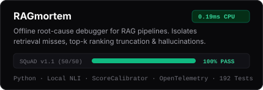
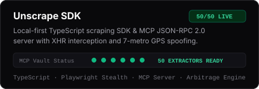
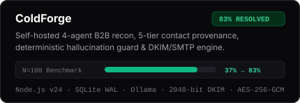
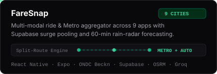

<div align="center">
  <a href="https://github.com/deveshkolte">
    
  </a>
</div>

<br />

<div align="center">
  <a href="https://github.com/deveshkolte/RAGmortem">
    
  </a>
</div>

<br />

### Selected Work

<div align="center">
  <a href="https://github.com/deveshkolte/RAGmortem"></a>
  <a href="https://github.com/deveshkolte/unscrape"></a>
</div>
<div align="center">
  <a href="#selected-work"></a>
  <a href="#selected-work"></a>
</div>

<br />

| Project | Overview | Links |
| :--- | :--- | :--- |
| **[RAGmortem](https://github.com/deveshkolte/RAGmortem)** | Offline, CPU-only root-cause debugger for RAG pipelines. Isolates retrieval misses, top-*k* ranking truncation, hallucinations, and abstention failures with embedding score calibration (`MiniLM`, `OpenAI`, `BGE`) and local NLI cross-encoder verification. | [GitHub](https://github.com/deveshkolte/RAGmortem) · [SQuAD v1.1 Report](https://deveshkolte.github.io/RAGmortem/) |
| **[Unscrape SDK](https://github.com/deveshkolte/unscrape)** | Local-first TypeScript scraping SDK and **Model Context Protocol (MCP)** JSON-RPC 2.0 server. Intercepts runtime XHR/Fetch and Next.js state payloads with hyperlocal 7-metro GPS spoofing and a stateful price-drop watchdog. | [GitHub](https://github.com/deveshkolte/unscrape) |
| **ColdForge** | Self-hosted 4-agent B2B intelligence, 5-tier contact provenance, and outreach engine on Node.js `node:sqlite` (WAL) with deterministic hallucination guards, wire-level 2048-bit RSA `DKIM` signing, and `AES-256-GCM` credential storage. | `Private Architecture` |
| **FareSnap** | Cross-city mobile ride & Metro aggregator for 9 Indian cities. Combines an async multi-provider quote engine (`ONDC Beckn` + 9 apps), Haversine Metro + Auto split-route calculation, Supabase surge pooling, and Open-Meteo 60-min rain-radar forecasting. | `Private Repo / APK` |
| **[Markdown Converter](https://github.com/deveshkolte/markdown-converter)** | Document-to-Markdown ingestion platform and RAG chunking/embedding pipeline supporting 8+ document formats across a Python CLI, FastAPI REST backend, and Next.js web workspace. | [GitHub](https://github.com/deveshkolte/markdown-converter) · [Live Web App](https://markitdown-web.vercel.app) |

---

### Stack

```text
Languages      :: Python (3.11+) · TypeScript · JavaScript (ES2024 / Node.js v24) · SQL · C
AI & Agents    :: Multi-Agent Orchestration · Model Context Protocol (MCP) · RAG Diagnostics · NLI Cross-Encoders · LangChain · LlamaIndex · Ollama · Groq
Systems & Data :: FastAPI · Node.js (node:sqlite WAL, node:tls, node:dns) · Playwright · PostgreSQL · Supabase · ChromaDB · Docker · GitHub Actions
Web & Mobile   :: Next.js 15 · React 19 · React Native (Expo) · Tailwind CSS
```

---

<div align="center">
  <a href="mailto:deveshkolte@gmail.com"><code>deveshkolte@gmail.com</code></a> &nbsp;&bull;&nbsp;
  <a href="https://linkedin.com/in/deveshkolte"><code>linkedin.com/in/deveshkolte</code></a> &nbsp;&bull;&nbsp;
  <a href="https://x.com/devesh13_"><code>x.com/devesh13_</code></a>
</div>
