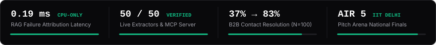

<div align="center">
  
</div>

<br />

<div align="center">
  
</div>

<br />

### Engineering Thesis

I build **deterministic AI evaluation engines, multi-agent orchestrators, Model Context Protocol (MCP) servers, and local-first developer tools**. Instead of wrapping prompt templates around black-box APIs, my work focuses on verifiable execution: isolating RAG pipeline failures on CPU in sub-millisecond latency without LLM judges, enforcing deterministic hallucination guards over scraped evidence, and shipping self-contained tools with zero mandatory cloud lock-in.

---

### Flagship Systems & Repositories

| System | Architecture & Core Mechanism | Verification / Artifact |
| :--- | :--- | :--- |
| **[RAGmortem](https://github.com/deveshkolte/RAGmortem)** | Offline, CPU-only root-cause failure debugger for RAG pipelines. Isolates retrieval misses, top-*k* ranking truncation, generator hallucinations, and abstention failures with embedding score calibration (`MiniLM`, `OpenAI`, `BGE`) and 2-tier lexical + local NLI cross-encoder verification. | **[PyPI (`ragmortem`)](https://pypi.org/project/ragmortem/)** · **[SQuAD v1.1 Report](https://deveshkolte.github.io/RAGmortem/)** (`100%` attribution · `0.19 ms` latency · `192` tests) |
| **[ColdForge](https://github.com/deveshkolte/coldforge)** | Self-hosted 4-agent B2B intelligence, 5-tier contact provenance, and outreach engine on Node.js `node:sqlite` (WAL). Features deterministic hallucination guards, wire-level DNS (`MX`/`SPF`/`DMARC`), 2048-bit RSA `DKIM` signing, and `AES-256-GCM` credential storage. | **`37% → 83%`** verified contact resolution on 100-prospect ground-truth benchmark |
| **[Unscrape SDK](https://github.com/deveshkolte/unscrape)** | Local-first TypeScript scraping SDK and **Model Context Protocol (MCP)** JSON-RPC 2.0 `stdio` server. Intercepts runtime XHR/Fetch and Next.js state payloads with hyperlocal dark-store GPS & pin-code spoofing across 7 Indian metros and a stateful price-drop watchdog. | **`50 / 50`** live commercial extractors passing (`Blinkit`, `Zepto`, `NSE`, `Amazon`) |
| **[FareSnap](https://github.com/deveshkolte/FareSnap)** | Cross-city mobile ride & commute aggregator for 9 Indian cities. Combines an async multi-provider quote engine (`ONDC Beckn` + 9 apps), Haversine Metro + Auto split-route calculation, Supabase crowdsourced surge pooling, and Open-Meteo 60-min rain-radar surge forecasting. | **[Android APK Release](https://github.com/deveshkolte/FareSnap/releases/latest)** (`React Native` · `Expo` · `Supabase` · `OSRM`) |
| **[Markdown Converter](https://github.com/deveshkolte/markdown-converter)** | Document-to-Markdown ingestion platform and RAG chunking/embedding pipeline supporting 8+ document formats across a Python CLI, FastAPI REST backend, and Next.js web workspace. | **[Live Web App](https://markitdown-web.vercel.app)** · **[API Docs](https://markdown-converter-0jsu.onrender.com/docs)** |

---

### Technical Stack

```text
Languages      :: Python (3.11+) · TypeScript · JavaScript (ES2024 / Node.js v24) · SQL · C
AI & Agents    :: Multi-Agent Orchestration · Model Context Protocol (MCP) · RAG Diagnostics · NLI Cross-Encoders · LangChain · LlamaIndex · Ollama · Groq
Systems & Data :: FastAPI · Node.js (node:sqlite WAL, node:tls, node:dns) · Playwright · PostgreSQL · Supabase · ChromaDB · Docker · GitHub Actions
Web & Mobile   :: Next.js 15 · React 19 · React Native (Expo) · Tailwind CSS
```

---

<div align="center">
  <a href="mailto:deveshkolte@gmail.com"><code>deveshkolte@gmail.com</code></a> &nbsp;&bull;&nbsp;
  <a href="https://linkedin.com/in/deveshkolte"><code>linkedin.com/in/deveshkolte</code></a> &nbsp;&bull;&nbsp;
  <a href="https://x.com/devesh13_"><code>x.com/devesh13_</code></a> &nbsp;&bull;&nbsp;
  <a href="https://pypi.org/project/ragmortem/"><code>pypi.org/project/ragmortem</code></a>
</div>
